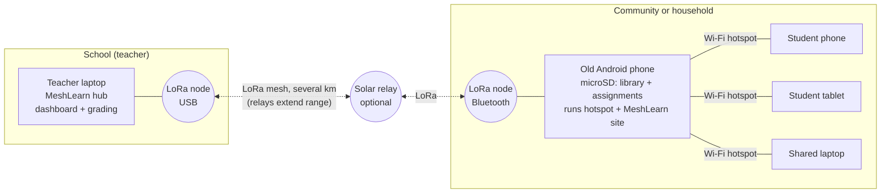

# MeshLearn

**Offline assignments and a local library for students in broadband deserts, linked by LoRa radio.**

ECEP 405 Global Engineering, Team 4 (Accessible Education), Fall 2026 prototype.

A teacher builds interactive assignments on a **teacher hub**. An **old Android phone** in the community keeps a copy of every assignment, plus an offline library, on its microSD card. It also runs a small website on its own Wi-Fi hotspot. The copies are loaded by memory card or over school Wi-Fi.

When the teacher opens an assignment, the hub sends a one-packet message over a Meshtastic LoRa mesh. Students join the hotspot with any device, read the library, and complete the work. The phone checks that answers are complete, batches several students' work together, and radios it back to the hub whenever the link is up. The teacher grades, and the results come back the same way.

The radio only carries a full assignment when the teacher adds or edits one after the phone's copy was loaded. No internet, cell signal, or ISP is needed at any point.



| Piece | What it does | Runs on |
| --- | --- | --- |
| Teacher hub | Courses with numbered units, assignment builder and editor, open/hide per phone, course pack export, auto-grading, manual grading of written answers, comprehension by student and unit, learning-data export/import, CSV export, card library browser | Any laptop with Python 3.9+ |
| Student phone | Stored assignments, student website organized by course and unit with the student's own levels, answer checking, timing, results, offline library, batched store-and-forward queue | Old Android phone with Termux, data on microSD |
| Mesh link | Compressed, chunked, acknowledged messages that resend only lost pieces and survive reboots | Meshtastic radios, or a built-in simulator |
| Library fetcher | Picks the best open content that fits the card (Kiwix offline Wikipedia, Wikibooks, Wikiversity, PhET, Project Gutenberg) in English, Portuguese, or German, and downloads it with resume | Any computer with internet, before deployment |

## Try it in two minutes (no hardware)

Needs Python 3.9 or newer and nothing else.

```bash
git clone https://github.com/Yitz42/Global_Engineering_Group_4.git
cd Global_Engineering_Group_4
python3 -m meshlearn demo
```

Then open:

- **Student phone:** http://localhost:8080. Enter a name, open "Fractions and plants check-in", answer it, and submit.
- **Teacher hub:** http://localhost:8000. Watch the submission arrive a few seconds later, grade the written answer, and save. The student's "My results" page updates over the radio.

On start, the demo plays out a school visit. The phone copies the assignment from the hub over "Wi-Fi", then the hub opens it with a single radio packet. The phone's status page at http://localhost:8080/status counts the radio packets sent.

The simulated radio drops 20% of packets, so you can watch the retries work. Change that with `--loss 0.5`.

**To see a fully set-up school,** run `python3 -m meshlearn demo --showcase`. It fills the demo with three weeks of made-up work:

- nine assignments across Mathematics, Science, and Reading and writing;
- three community phones and 13 students of different abilities;
- graded work and practice tries, a few written answers waiting for the teacher, and the odd student rushing.

The five students on the demo phone (Lena, Ana, Bruno, Kofi, Mateus) send their work through the simulated radio. Type one of those names on the student site to see their courses, levels and grades.

## Running on real hardware

1. **Get radios.** See [docs/hardware.md](docs/hardware.md) for recommended boards, antennas, power, and the right frequency band for the US, Brazil, Germany, and Kenya.
2. **Flash Meshtastic** on each radio (https://flasher.meshtastic.org), set the region, and give MeshLearn its own private channel on every radio ([docs/hardware.md](docs/hardware.md#6-setting-up-the-radios) shows how). Then check the pair on a desk with `python3 -m meshlearn radio-test` ([bench test](docs/hardware.md#7-bench-test-with-two-radios)).
3. **Teacher hub:** plug a radio into the laptop by USB, then double-click the start file in the MeshLearn folder:
   - **Mac:** `start-hub.command`. The first time, macOS may refuse to open it: right-click it, choose **Open**, then **Open** again.
   - **Windows:** `start-hub.bat`.
   - **Linux:** run `bash start-hub.command`.

   The first start needs internet for about a minute. It installs the radio software into a private `.venv` folder, so nothing else on the computer changes. After that the hub works offline.

   Each start finds the radio's USB port and the channel named MeshLearn by itself, then opens the hub in the browser. Keep the window open while you work; closing it stops the hub. If two radios are plugged in, it asks which one is the hub's.

   A new hub offers **Add example lessons** (nine lessons in mathematics, science and reading) to test with.
   The **Phones and radio** page shows this hub's radio id to type into each phone. With the MeshLearn app on the phone, scanning the QR code on that page fills in the radio id and channel instead. Phones register themselves the first time they check in.

   The start file lets other devices on the school Wi-Fi reach the hub, so phones can copy assignments from it. To run the hub by hand, use:
   ```bash
   python3 -m pip install meshtastic
   python3 -m meshlearn hub --radio-serial --host 0.0.0.0      # or name the port: --radio-serial /dev/cu.usbmodem1101, COM3
   ```
   Add `--radio-channel 3` to use a channel slot other than the one named MeshLearn.
4. **Student phone:** follow [docs/android-setup.md](docs/android-setup.md) to install Termux, put the data on the microSD card, pair the phone with its radio over Bluetooth, and start:
   ```bash
   python -m meshlearn phone --data ~/storage/external-1/meshlearn --hub '!a1b2c3d4' --name "North village" --radio-ble Meshtastic_e023 --radio-channel 3
   ```
5. **Load the assignments** while the phone is at school. Either way puts a copy of every assignment on the phone with no radio traffic:
   - **School Wi-Fi:** open `http://localhost:8080/status` in the phone's browser and enter the hub's address.
   - **Memory card:** download the course pack from the hub dashboard and unzip it into the phone's MeshLearn folder, or run:
     ```bash
     python3 -m meshlearn pack --out /Volumes/SDCARD/Android/data/com.termux/files/meshlearn
     ```
   **Phones and radio**, **Lessons** shows what each phone has and lacks. It can send a few missing lessons by radio (up to 40 packets), or fill a phone's memory card in this laptop's card reader: lessons first, then the chosen books. It never pre-selects a drive that holds no MeshLearn folder.
6. **Fill the library** before the phone leaves an area with internet. Open **Card library** on the hub, choose collections, and press **Copy to memory card** with the phone's card in the laptop's card reader (see below). Or, without the browser:
   ```bash
   python3 -m meshlearn library --sd-gb 32 --lang pt --dest /Volumes/SDCARD/Android/data/com.termux/files/meshlearn/library --dry-run
   ```
   Drop `--dry-run` to download. Run it again to resume an interrupted download. To download what was chosen on the hub page, use `--from-hub hub-data` in place of `--sd-gb`.

## How the work is organized

MeshLearn follows the organization of the team's **Engineering Mechanics Sandbox**: courses, numbered units, comprehension worked out quietly from every answer, and one learning-data file.

### Courses and units

Every assignment belongs to a unit of a course, for example *Mathematics · Unit 1: Numbers and fractions*.

- **Starter courses** come from [`meshlearn/courses.json`](meshlearn/courses.json): Mathematics, Science, and Reading and writing, plus Engineering mechanics marked "Coming later". The team edits this file.
- **Teacher changes win.** On the hub's **Courses** page, teachers add courses, rename or add units, and say what each unit's "Find readings" link should search the library for. Once a course is changed on the hub, the hub keeps its version even if the file changes. Untouched courses follow the file.
- **What students see.** Students get course cards with their own level, then the course's numbered units with that unit's open assignments, a link to readings in the library, and their level in the unit. Unbuilt courses show as "Coming later".
- **Course names reach every phone.** Course and unit titles travel inside each assignment, so a phone that only ever hears from the hub by radio still shows the courses. Phones loaded with a course pack also get each course's description and empty units.

### Comprehension

The hub's **Class progress** page scores every student in every unit and course from their graded answers, using the sandbox's rules:

| | |
| --- | --- |
| Graded assignment | Points earned ÷ points possible, per question |
| Practice assignment | 1.0 right first time, 0.6 right on the second try, 0.3 later, 0 never right |
| Unit | Average of the student's 20 most recent scored questions in it |
| Course | Average of its units that have answers |
| Levels | Strong 85%+, Good 65%+, Developing 40%+, Needs work below 40%; fewer than 3 answers is "Just started" |

**Where the mistakes are.** Every answer that lost marks is sorted into an area:

- **Calculation:** sign flipped, place value off by 10, 100 or 1000, rounded too far, fraction upside down.
- **Understanding:** wrong multiple-choice option.
- **Recall:** wrong word or fact.
- **Explaining:** written answer below half marks.

**How long it took.** The phone times each assignment from opening it to submitting. That gives signals that are worth a look but never proof:

- **rushing:** fast and wrong;
- **very fast and right:** outside help?
- **much slower than expected:** stuck?

Students see their own levels on their course cards and on **My results**.

### Where students went wrong

- **Notes on wrong answers.** In the builder, or straight from the class's answers, the teacher says what a wrong answer shows: for 1/4 + 1/2, "2/6: added tops and bottoms". A fraction also matches its decimal (0.33). Notes stay on the laptop. They are never sent to phones and cost no radio.
- **The class view.** Each assignment's page shows every question: how many got it right, each wrong answer with its note and who gave it, and at the top the mistakes most students share. A practice counts each student's first try.
- **Not sure, and changed answers.** Students can tick "I'm not sure about this one", which never changes their mark (ages 5 to 7 don't see it). If they change an answer after moving on, the first one is sent too. So the teacher sees right answers that were guesses, and right answers that were changed to wrong ones. For 10 students on a 20-question test this added 72 to 92 bytes (about 680 to about 760) and no extra packet.
- **Class progress.** Beside the grid: a unit's most common mistakes, students worth a look, and **Make a practice** from the questions students missed that way. A practice sends its right answers to phones, so questions from assignments whose answers must still stay on the laptop are left out.
- **Notes back.** When marking, the teacher can add a note of up to 60 letters. It travels with the marks and shows on the student's results.

### Learning data

The hub home page's **Learning data** panel exports everything in one anonymous JSON file. That covers courses, every assignment version with its answer key, and every submission with answers, scores, mistake kinds, timing and pace signal.

- **Pseudonyms, not names.** Student and phone names are replaced by pseudonyms, from a secret that never leaves the hub, so the same student always gets the same pseudonym.
- **Built to stay readable.** The file has a format name, a version, an `encoding` field and a dictionary of its fields, so it can still be read as MeshLearn changes.
- **Import only adds.** Importing another hub's file adds its data, skips submissions already present and never deletes anything, so the team can pool results from several schools.

## Choosing what goes on the card

The hub's **Card library** page lists every collection in the [Kiwix](https://library.kiwix.org) catalog that can go on a phone. In October 2026 that was 3,658 collections in more than 100 languages, plus a set of classic novels from Project Gutenberg. It also lists the courses on [Kolibri](https://learningequality.org/kolibri/) that a plain browser can open (154 in November 2026). The list is downloaded once (about 5 MB) and kept on the hub, so it can be browsed offline afterwards.

**Learning material comes first.** Each collection gets a label and a level, set by simple rules from its category, name, tags and description:

| Level | Examples |
| --- | --- |
| Core learning | PhET science simulations, Wikibooks and LibreTexts textbooks, Wikiversity, Khan Academy, CrashCourse, Art of Problem Solving, OER4Schools, Vikidia and Klexikon (encyclopedias for children) |
| Learning reference | Wikipedia, Wiktionary, Wikisource and Gutenberg books, TED talks, freeCodeCamp, ProofWiki, MedlinePlus, and anything whose description mentions courses, lessons, students or school subjects |
| General interest | Wikivoyage, Wikiquote, Stack Exchange Q&A, iFixit repair guides, software docs, maps |
| Not school-related | Game and fan wikis |

**Suited to the students' ages.** The teacher ticks the students' age groups: 5–8, 9–11, 12–14, 15–18, or teachers and adults. The default is 12–14 and 15–18, the project's secondary-school learners. Groups go by age rather than grade, so they mean the same in every country.

The catalog has no age data, so MeshLearn estimates a range for each collection:

- **Known collections have fixed ranges.** Examples: picture books 3–9, Klexikon 6–12, Vikidia 8–13, PhET 8+, Wikibooks 13+, Wikiversity 15+, university textbooks 17+, teacher resources for adults.
- **Others are read from their descriptions.** Words like "kids", "middle school", "high school", "university" or "teachers" set the range.
- **The rest are marked "12+ (estimated)".**

A collection counts as suited when its range shares at least two years with a chosen group. Each collection shows its age range as a badge.

By default the page shows only collections that suit the chosen ages, at the first two education levels, in the students' language. The teacher can show any age (suited ones still come first), switch to core learning only or everything, filter by kind, or search ("biology", "math").

**Fitting the card.** The teacher enters the card size, and each collection shows its versions with sizes: article intros (mini), text only (nopic), or with images (maxi). A bar tracks how much of the card the picks use and warns when they don't fit. "Suggest a starter set" fills the card automatically for English, Portuguese or German, using only collections that suit the students' ages.

For young children that means picture books, children's encyclopedias, TED talks for kids and science simulations, rather than Wikiversity or university textbooks. A chosen collection outside the students' ages is flagged.

**Kolibri courses, topic by topic.** Kolibri publishes courses such as Khan Academy in dozens of languages, split into topics. **Choose topics…** downloads a course's list of lessons (usually a few MB), and the teacher adds a grade or a topic at a time. For example, Khan Academy in Swahili is 1,106 videos (2.7 GB), and its first-grade maths is 31 videos (38 MB).

- **What is offered:** videos, sound, PDFs, e-books and interactive activities (PhET simulations, Blockly Games) with an open licence (Creative Commons or public domain). Students open them in the MeshLearn library, without the Kolibri app.
- **What is left out:** exercises, which need Kolibri; lessons with other licences; and material marked for teachers only, such as answer keys.
- **Counted once:** a video listed under several topics is copied once. Adding a bigger topic replaces the smaller ones inside it.
- **On the phone:** each course gets one card under **Courses** in the Library, in the course's own order, with each lesson's author and licence. Students can skip ahead in videos.

**GeoGebra.** The **Tools** kind offers GeoGebra's graphing, geometry, 3D and calculator apps as one 33 MB file, for offline use. GeoGebra is free for non-commercial use only, so leave it off any card that is sold or part of a paid service.

**Activities run walled off.** PhET, Blockly and GeoGebra are other people's programs. They stay in their zip files on the card, and the phone gives each one a browser sandbox: no forms, no sign-in cookie, and no requests to anything but its own files, so their usage tracking is blocked too. The phone also refuses button presses that come from a sandbox. GeoGebra cannot start in its own origin, so it runs as a whole page with the same limits otherwise.

**Copying to the card.** "Copy to memory card" downloads the picks straight onto a card in the laptop's card reader. It runs in the background with a progress bar, can be stopped and resumed, and skips files already on the card. The phone's Library page lists everything once the card is back in the phone.

Only the hub laptop's own browser can start downloads or update the list, since both write to that laptop's disk.

## What fits on the card

The fetcher looks up current file sizes from the Kiwix catalog every time it runs, so these plans change as the collections are updated. These are the automatic starter sets as of October 24, 2026, keeping 2 GB free for assignments and the system.

**Secondary students (ages 12–18, the default):**

| Card | Language | Starter set | Total |
| --- | --- | --- | --- |
| 8 GB | English | PhET, Vikidia, Wikipedia 100, 10 classic books, Best of Wikipedia (intros), Wikibooks (text only) | 4.3 GB |
| 16 GB | Portuguese | PhET, Vikidia, Wikilivros, all of Wikipédia (text only) | 7.3 GB |
| 32 GB | English | PhET, Vikidia, 10 classic books, Wikibooks, Wikiversity, all of Wikipedia (intros) | 23.2 GB |
| 64 GB | German | PhET, Wikibooks, all of Wikipedia with images | 52.3 GB |

**Younger students (ages 5–11):**

| Card | Language | Starter set | Total |
| --- | --- | --- | --- |
| 8 GB | Portuguese | PhET, Vikidia, TED kids, Best of Wikipédia (text only) | 5.2 GB |
| 16 GB | English | PhET, Vikidia, Prunelle picture books, Wikipedia 100, Best of Wikipedia, TED kids | 11.9 GB |
| 16 GB | German | PhET, Klexikon, TED kids, Best of Wikipedia | 8.8 GB |

Run `python3 -m meshlearn library --sd-gb <size> --lang <en|pt|de> --ages <groups> --dest <folder> --dry-run` to see the plan for any card. Age groups are `early` (5–8), `primary` (9–11), `lower` (12–14), `upper` (15–18) and `adult`. Content keeps its original license (Wikipedia projects: CC BY-SA; PhET: CC BY 4.0; TED talks: CC BY-NC-ND; Project Gutenberg texts: public domain in the USA).

## How the mesh link works

### What travels by radio

Assignments live on both the hub and the phone, so the radio mostly carries answers and grades. These counts are packets for a 20-question review completed by 10 students. Each message also gets a one-packet acknowledgement, not counted here.

| Step | Assignment sent by radio each time | With a stored copy and batching |
| --- | --- | --- |
| Get the assignment to students | 5 packets | **1 packet** (open message) |
| 10 students' answers | 20 packets (2 each) | **2 packets** (one batch) |
| 10 grades back | 10 packets | **1 packet** (one batch) |
| **Total** | **35 packets** | **4 packets** |

The full assignment travels by radio only when it is new or edited after the phone's copy was loaded. Even then it is 3 packets for this 20-question review, and 2 for the sample assignment.

Moving a due date or hiding an assignment is always 1 packet.

### How it stays reliable

- **Stored copies stay in step.** Every assignment carries a version stamp computed from its content. Phones report their versions when they check in. The hub sends a full copy only when a phone's copy is missing or out of date, including after an edit. If an open message reaches a phone without the right copy, the phone asks for it.
- **Answers are graded against what the student saw.** Each submission records the version it was written against, and the hub keeps every version.
- **Small packets.** Each message is compressed with zlib using a shared dictionary of words common in assignments, so short messages compress well. It is then split into 219-byte frames. Meshtastic advertises 233 bytes, but current firmware keeps 12 for encryption and silently drops anything over 219, as a test with two real radios showed. Assignments use a compact format with short field names, and defaults are left out.
- **Only lost pieces are resent.** When a burst ends with pieces missing, the receiver asks for exactly those. If the sender hears nothing, it sends one probe packet instead of the whole message. At 20% packet loss, a 10-packet message costs about 13 transmissions this way, compared with about 90 if the whole message were resent.
- **Nothing is lost.** Every outgoing message is written to SQLite before it is sent. Retries back off from 30 s up to 10 min on real radios. If a phone reboots or the link is down for days, the queue picks up where it left off.
- **No duplicates.** The receiver remembers which messages it has handled. It re-acknowledges a repeat without acting on it twice.
- **The answer key stays home.** In graded mode, the phone's copy has no answers, so nothing on the memory card gives them away, and grading happens on the hub. In practice mode the key is included, so students get instant right/wrong feedback. The day after a graded assignment's due date, the hub sends each student the right answers to the questions they missed (the teacher can send them sooner, or turn this off).
- **Separate from chat.** MeshLearn uses Meshtastic's `PRIVATE_APP` port, so ordinary Meshtastic text messages on the same mesh are unaffected.

## Accessibility and adaptation built in

- Works in any browser on any device that can join Wi-Fi; no app install for students.
- Large touch targets, visible labels on every field, error messages linked to their fields for screen readers, and light and dark themes that follow the device.
- **Three looks, by age.** Ages 5–7 get big pictures, stars and few words; ages 8–11 get one thing to do next; ages 12 and up get due dates, course scores and what to review. The hub's students' ages decide which looks a phone offers, and when there is more than one, students pick their age on the welcome page.
- **Signing in.** With a class list on the hub's **Students** page, ages 5–7 tap their picture (and a secret picture, if the teacher turns it on), ages 8–11 find their name, and ages 12 and up type it (and a PIN, if turned on). Students who are not on the list can start anyway; the hub asks the teacher who they are. The phone goes back to "Who are you?" after a while with no taps. Without a list, students type their name.
- **Pictures in questions.** 289 drawings come with every phone, so a question sends only a picture's name (`apple*3, ball`). They can also stand for the answers.
- **The school's own pictures.** On the hub's **Pictures** page the teacher can draw one, recolour or draw on a library picture, or use a photo. A simple drawing is one radio packet and travels with the lesson that uses it. A photo (about 15 KB, with its location data left out) goes by Wi-Fi or memory card only; until it arrives, students see its name. Names can be given in each of the school's languages.
- **Keep reading.** The library offers each student the last thing they opened.
- **Listen.** A button reads the page or the question aloud in the student's language, on devices that have a voice for it (inside the Android app, the phone's own voice). It hides itself where there is none.
- **One question at a time.** Arrows move back and forward, and **Review** lists every question with the student's answer, what is still blank and what they ticked "Come back to this later". Answers and the place in the lesson are kept in the browser. Without JavaScript, every question shows in one list.
- **Equations.** Teachers write them between `\(` and `\)`, like `\(\frac{1}{2} + x^2\)`, and KaTeX draws them on the phone.
- **Scratchpad.** The pencil opens squared paper to work things out on, one sheet per question. It stays in the student's browser and is never sent.
- **Reading help.** **Aa** makes the text bigger, spaces it out or switches it to OpenDyslexic. Each student's browser remembers the choice.
- **Questions from a spreadsheet.** The assignment builder imports a CSV file, notes on wrong answers included, and lists any row whose answer doesn't fit.
- **Question info.** A question can carry a text, a table or data (up to 2,000 characters). On a phone students pull it down above the question; on a computer it stays open at the side. Several questions about the same text share it, so it travels by radio once. The assignment's instructions are in the same panel.
- Numbers accept `3.5`, `3,5` (comma decimals used in Brazil and Germany), and fractions like `3/4`.
- **The school's own language.** On the hub's **Language** page the teacher picks the language the school teaches in, from any language in the library catalog (more than 100). That one choice sets the words students see on every phone and the books suggested for the memory card. Up to two more languages are optional: students pick theirs on the welcome page and can switch at the top of any page. Right-to-left languages such as Arabic and Urdu mirror the whole page.
- **Languages by country.** Choosing the school's country sets its languages for learning, main one first. Any of it can be changed afterwards.

  | Country | Languages | Note |
  | --- | --- | --- |
  | Germany | German, English, French | English is left out when all students are under 12; French is European French |
  | Kenya | English, Swahili, French | English comes before the native language |
  | United States | English, Spanish, French | |
  | Brazil | Portuguese, English, German | Brazilian Portuguese (`lang/por-BR.json` holds the words that differ from `por.json`) |

- **Questions in each language.** An assignment's **Languages** page puts the original beside a column for each of the school's languages: title, instructions, questions, options and info. Where a translation is missing, students see the original. It says how many students that affects, and which translations to check after the original changed. Phones get only the languages their students use. The radio size is shown.
- **The teacher's voice.** An assignment's **Voice** page records each question and answer word (about 3 KB a second), for phones with no voice in that language. **Listen** plays the recordings in order and reads the rest aloud where it can. A word is recorded once per language and used everywhere it shows. Recordings go by Wi-Fi or memory card, never by radio. Recording needs a microphone and works on the hub laptop itself; sound files can be added instead.
- **Each student's language.** **Language**, **In the class** shows which language each student works in, and sets where they start. On a shared phone the choice belongs to the student, not the browser.
- **Translations that can be partly done.** MeshLearn comes with every phone word in German, Spanish, French, Portuguese (European and Brazilian), Kiswahili and Arabic (`meshlearn/lang/`; not yet checked by native speakers). Any other language starts in English and the teacher translates word by word on the hub; anything not yet translated shows in English. Translations travel to phones with the lessons (Wi-Fi copy or memory card, never the radio), and can be downloaded and shared with other schools or sent to the project.
- Text-only and smaller library editions are chosen automatically for small cards.
- Students identify themselves by name, with no accounts or personal data beyond what the teacher needs. Secret pictures and PINs keep classmates honest but are not strong protection: phones carry only a hash of each, and slow down guessing, yet a 4-number PIN can be worked out by someone with the phone's files. The class list is copied over Wi-Fi to any phone that syncs.

## Project layout

```
start-hub.command    double-click start for the teacher hub on a Mac (or bash start-hub.command on Linux)
start-hub.bat        the same on Windows
meshlearn/
  protocol.py        message format: dictionary compression, framing, missing-piece reports
  transport.py       simulated radio (UDP) and real Meshtastic radios (Bluetooth, USB or Wi-Fi)
  radioports.py      finds the radio plugged in by USB, and the channel named MeshLearn on it
  messenger.py       store-and-forward delivery: acks, selective resend, de-duplication
  radiotest.py       bench test for two real radios on one computer (radio-test)
  assignments.py     question types, compact format, version stamps, answer checking, grading
  courses.py         courses and numbered units; courses.json holds the starter courses
  comprehension.py   scores per unit and course, mistake kinds, timing signals (sandbox rules)
  hub.py             teacher dashboard, open/hide per phone, course pack export
  hubui.py           the hub's sidebar and everyday pages: Today, Marking, Assignments, Phones and radio,
                     and the example lessons a new hub can start from
  hubpages.py        hub pages for courses, comprehension and learning data (export / import)
  hubstudents.py     the class list: students, their pictures and how they sign in
  hublang.py         hub pages for the school's language: choose it, translate words, share them
  language.py        the words students see, in the school's language, falling back to English
  lang/              those words: eng.json (every word) and the translations that come with MeshLearn
  showcase.py        a realistic made-up school for demos (demo --showcase)
  phone.py           stored assignments, student website by course, timing, batching, library browser
  library.py         open-content planner and downloader
  catalog.py         full Kiwix catalog: education rating, card budget, background copy to card
  kolibri.py         Kolibri's public courses: topics, lessons, licences and files for the card
  hubtranslate.py    an assignment in the school's languages
  hubvoice.py        recording the teacher's voice for an assignment
  voices.py          which words a recording belongs to, and its files
  hubpictures.py     the Pictures page: browse, draw, photos, change one of ours
  ownpics.py         the school's own pictures, small enough for the radio
  hublessons.py      what each phone has, filling a memory card, the printed setup card
  hubbuilder.py      the assignment builder: question cards, notes, phone preview, radio size
  hubclass.py        the class view of an assignment, and class progress
  hubkolibri.py      hub pages for choosing Kolibri topics
  zipapps.py         activities on the card (PhET, Blockly, GeoGebra), walled off; the joining QR code
  phonesignin.py     signing in on the phone by picture, name or PIN
  web.py             tiny standard-library web framework
  site/              the student site's look, icons, picture library and scripts, shared with the Android app
  site/vendor/       ready-made libraries and their licences (NOTICES.md): KaTeX, Signature Pad, OpenDyslexic, Papa Parse, QR codes
  starter_library/   three short original lessons included on every phone
  sample_assignment.json
tests/test_meshlearn.py
docs/hardware.md, docs/android-setup.md
```

## Tests

```bash
python3 -m unittest discover -s tests -v
```

They cover:

- framing, corruption, and missing-piece reports;
- lossless compact format;
- question info that several questions share, and the arrows and review on the student's page;
- languages set by country, with three on one phone;
- the three looks by age;
- signing in by picture, secret picture and PIN, and names that are not on the list;
- pictures in questions, keep reading, and right answers only after the due date;
- version stamps;
- grading and validation;
- the library planner;
- delivery through 40% simulated loss, with each message delivered exactly once;
- selective resend staying under 4× the message size at 30% loss, and a missing-pieces reply that arrives mid-burst not being lost;
- catalog parsing, education rating, and age ranges;
- starter courses and hub edits winning over the file;
- comprehension scoring for graded and practice work, levels, mistake kinds and timing signals;
- learning-data export with no real names, and import that skips doubles;
- starter sets that fit the card;
- Kolibri topics from the channel's list to the student library: licences, repeated files, stopped copies and skipping ahead in a video;
- notes on wrong answers (never on a phone, never a new version), not-sure ticks, changed answers, the class view, practice from a mistake, and notes back;
- the school's own pictures by Wi-Fi, card and radio (both phones draw the same), and bad ones refused;
- translated questions and the teacher's recordings, from the hub's pages to both phones;
- what each phone has, filling a card, and each student's language;
- activities on the card: the sandbox, path traversal, refused button presses, and ready-made libraries served by name only;
- copying chosen collections onto a card from a local test server.

End-to-end tests run through both websites:

- radio-only delivery, then grading and results;
- a Wi-Fi sync followed by a 1-packet open;
- a memory-card course pack;
- a phone fetching a copy it was missing;
- editing an assignment after students answered;
- three students' work sharing one radio message;
- a student's course cards, unit pages, timing and levels;
- the hub's course, comprehension and learning-data pages;
- library traversal protection.

## Status and limits

Tested:

- Everything above, on Python 3.9 on macOS, using the simulated radio.
- **Real Meshtastic radios on a desk.** A RAK4631 and a Wio Tracker L1, 1 m apart, ran the hub and phone through a full cycle with no resends, with the phone's radio on USB and then on Bluetooth (from a Mac). See the [bench test](docs/hardware.md#7-bench-test-with-two-radios).
- The library fetcher's live lookups against the Kiwix catalog and Project Gutenberg, and a real download.
- Kolibri: the live list, topics from two courses, a real copy of 24 Swahili lessons (checksums matched), and one of them playing in the Android app on an emulator with the lessons on its memory card. Several students watching videos from one phone has not been tried.
- Ready-made tools, on Windows (Python 3.12) and in the Android app on an emulator: a real copy of 7 PhET simulations, 8 Blockly Games and GeoGebra (Kolibri checksums matched), the scratchpad, the joining QR code and the phone setup link. On the computer, spreadsheet import, including a German Excel file. No QR code has been scanned with a real camera yet, and GeoGebra has not been tried on a slow phone.
- The notes, class view and builder in a desktop browser on the made-up school (simulated radio), and the student side in the Android app on an emulator. No teacher or class has used them yet.
- Recordings of a generated tone in place of a microphone, copied over Wi-Fi and played in order in a browser and in the Android app on an emulator. No one has recorded a real voice yet.

Not yet tested:

- **Bluetooth from the Android phone.** Bluetooth worked from a Mac. Python running in Termux probably can't reach Bluetooth at all, because the library MeshLearn uses (bleak) has no Termux support. The phone app may need to be packaged as a real Android app; see [docs/android-setup.md](docs/android-setup.md#4-turn-on-the-hotspot-and-pair-the-radio).
- **Termux on Android.** The steps in the setup guide have not been run on a phone yet.
- **Airtime and range at the pilot site.** Field testing will set the retry timing and the submission batch window, which defaults to 120 s. It will also show how many relays a site needs.

Still to build:

- Multimedia in assignments.
- Teacher accounts.
- Over-the-air library updates.
- Encryption beyond Meshtastic's channel key.

## Team

Karen Makena, Yitzchuk Rosenblat, Bruck Asefa, James Shamshoian, Fiona Acquah, with partners at H-BRS (Germany) and Instituto Mauá (Brazil).
