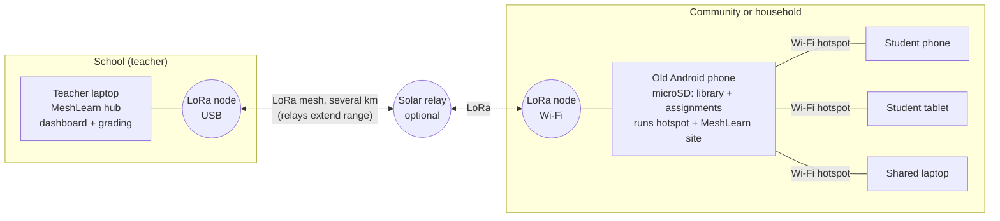

# MeshLearn

**Offline assignments and a local library for students in broadband deserts, linked by LoRa radio.**

ECEP 405 Global Engineering, Team 4 (Accessible Education), Fall 2026 prototype.

A teacher builds interactive assignments on a **teacher hub**. An **old Android phone** in the community keeps a copy of every assignment, plus an offline library, on its microSD card. It also runs a small website on its own Wi-Fi hotspot. The copies are loaded by memory card or over school Wi-Fi.

When the teacher opens an assignment, the hub sends a one-packet message over a Meshtastic LoRa mesh. Students join the hotspot with any device, read the library, and complete the work. The phone checks that answers are complete, batches several students' work together, and radios it back to the hub whenever the link is up. The teacher grades, and the results come back the same way.

The radio only carries a full assignment when the teacher adds or edits one after the phone's copy was loaded. No internet, cell signal, or ISP is needed at any point.



| Piece | What it does | Runs on |
| --- | --- | --- |
| Teacher hub | Assignment builder and editor, open/hide per phone, course pack export, auto-grading, manual grading of written answers, CSV export, card library browser | Any laptop with Python 3.9+ |
| Student phone | Stored assignments, student website with answer checking, results, offline library, batched store-and-forward queue | Old Android phone with Termux, data on microSD |
| Mesh link | Compressed, chunked, acknowledged messages that resend only lost pieces and survive reboots | Meshtastic radios, or a built-in simulator |
| Library fetcher | Picks the best open content that fits the card (Kiwix offline Wikipedia, Wikibooks, Wikiversity, PhET, Project Gutenberg) in English, Portuguese, or German, and downloads it with resume | Any computer with internet, before deployment |

## Try it in two minutes (no hardware)

Needs Python 3.9 or newer and nothing else.

```bash
git clone https://github.com/Yitz42/Global_Engineering_Group_4.git
cd Global_Engineering_Group_4
python3 -m meshlearn demo
```

Then open:

- **Student phone:** http://localhost:8080. Enter a name, open "Fractions and plants check-in", answer it, and submit.
- **Teacher hub:** http://localhost:8000. Watch the submission arrive a few seconds later, grade the written answer, and save. The student's "My results" page updates over the radio.

On start, the demo plays out a school visit. The phone copies the assignment from the hub over "Wi-Fi", then the hub opens it with a single radio packet. The phone's status page at http://localhost:8080/status counts the radio packets sent.

The simulated radio drops 20% of packets, so you can watch the retries work. Change that with `--loss 0.5`.

## Running on real hardware

1. **Get radios.** See [docs/hardware.md](docs/hardware.md) for recommended boards, antennas, power, and the right frequency band for the US, Brazil, Germany, and Kenya.
2. **Flash Meshtastic** on each radio (https://flasher.meshtastic.org), set the region, and put all radios on the same channel.
3. **Teacher hub:** plug a radio into the laptop by USB and run:
   ```bash
   pip install meshtastic
   python3 -m meshlearn hub --radio-serial /dev/ttyUSB0      # Windows: --radio-serial COM3
   ```
   Open http://localhost:8000. On the **Phones** page, add each community phone by its radio node id (for example `!a1b2c3d4`). Phones also register themselves the first time they check in.
   Add `--host 0.0.0.0` if phones will copy assignments from this laptop over school Wi-Fi.
4. **Student phone:** follow [docs/android-setup.md](docs/android-setup.md) to install Termux, put the data on the microSD card, connect the phone to its radio over Wi-Fi, and start:
   ```bash
   python -m meshlearn phone --data ~/storage/external-1/meshlearn --hub '!a1b2c3d4' --name "North village" --radio-host 192.168.43.20
   ```
5. **Load the assignments** while the phone is at school. Either way puts a copy of every assignment on the phone with no radio traffic:
   - **School Wi-Fi:** open `http://localhost:8080/status` in the phone's browser and enter the hub's address.
   - **Memory card:** download the course pack from the hub dashboard and unzip it into the phone's MeshLearn folder, or run:
     ```bash
     python3 -m meshlearn pack --out /Volumes/SDCARD/Android/data/com.termux/files/meshlearn
     ```
6. **Fill the library** before the phone leaves an area with internet. Open **Card library** on the hub, choose collections, and press **Copy to memory card** with the phone's card in the laptop's card reader (see below). Or, without the browser:
   ```bash
   python3 -m meshlearn library --sd-gb 32 --lang pt --dest /Volumes/SDCARD/Android/data/com.termux/files/meshlearn/library --dry-run
   ```
   Drop `--dry-run` to download. Run it again to resume an interrupted download. To download what was chosen on the hub page, use `--from-hub hub-data` in place of `--sd-gb`.

## Choosing what goes on the card

The hub's **Card library** page lists every collection in the [Kiwix](https://library.kiwix.org) catalog that can go on a phone. In October 2026 that was 3,658 collections in more than 100 languages, plus a set of classic novels from Project Gutenberg. The list is downloaded once (about 4 MB) and kept on the hub, so it can be browsed offline afterwards.

**Learning material comes first.** Each collection gets a label and a level, set by simple rules from its category, name, tags and description:

| Level | Examples |
| --- | --- |
| Core learning | PhET science simulations, Wikibooks and LibreTexts textbooks, Wikiversity, Khan Academy, CrashCourse, Art of Problem Solving, OER4Schools, Vikidia and Klexikon (encyclopedias for children) |
| Learning reference | Wikipedia, Wiktionary, Wikisource and Gutenberg books, TED talks, freeCodeCamp, ProofWiki, MedlinePlus, and anything whose description mentions courses, lessons, students or school subjects |
| General interest | Wikivoyage, Wikiquote, Stack Exchange Q&A, iFixit repair guides, software docs, maps |
| Not school-related | Game and fan wikis |

**Suited to the students' ages.** The teacher ticks the students' age groups: 5–8, 9–11, 12–14, 15–18, or teachers and adults. The default is 12–14 and 15–18, the project's secondary-school learners. Groups go by age rather than grade, so they mean the same in every country.

The catalog has no age data, so MeshLearn estimates a range for each collection:

- **Known collections have fixed ranges.** Examples: picture books 3–9, Klexikon 6–12, Vikidia 8–13, PhET 8+, Wikibooks 13+, Wikiversity 15+, university textbooks 17+, teacher resources for adults.
- **Others are read from their descriptions.** Words like "kids", "middle school", "high school", "university" or "teachers" set the range.
- **The rest are marked "12+ (estimated)".**

A collection counts as suited when its range shares at least two years with a chosen group. Each collection shows its age range as a badge.

By default the page shows only collections that suit the chosen ages, at the first two education levels, in the students' language. The teacher can show any age (suited ones still come first), switch to core learning only or everything, filter by kind, or search ("biology", "math").

**Fitting the card.** The teacher enters the card size, and each collection shows its versions with sizes: article intros (mini), text only (nopic), or with images (maxi). A bar tracks how much of the card the picks use and warns when they don't fit. "Suggest a starter set" fills the card automatically for English, Portuguese or German, using only collections that suit the students' ages.

For young children that means picture books, children's encyclopedias, TED talks for kids and science simulations, rather than Wikiversity or university textbooks. A chosen collection outside the students' ages is flagged.

**Copying to the card.** "Copy to memory card" downloads the picks straight onto a card in the laptop's card reader. It runs in the background with a progress bar, can be stopped and resumed, and skips files already on the card. The phone's Library page lists everything once the card is back in the phone.

Only the hub laptop's own browser can start downloads or update the list, since both write to that laptop's disk.

## What fits on the card

The fetcher looks up current file sizes from the Kiwix catalog every time it runs, so these plans change as the collections are updated. These are the automatic starter sets as of October 24, 2026, keeping 2 GB free for assignments and the system.

**Secondary students (ages 12–18, the default):**

| Card | Language | Starter set | Total |
| --- | --- | --- | --- |
| 8 GB | English | PhET, Vikidia, Wikipedia 100, 10 classic books, Best of Wikipedia (intros), Wikibooks (text only) | 4.3 GB |
| 16 GB | Portuguese | PhET, Vikidia, Wikilivros, all of Wikipédia (text only) | 7.3 GB |
| 32 GB | English | PhET, Vikidia, 10 classic books, Wikibooks, Wikiversity, all of Wikipedia (intros) | 23.2 GB |
| 64 GB | German | PhET, Wikibooks, all of Wikipedia with images | 52.3 GB |

**Younger students (ages 5–11):**

| Card | Language | Starter set | Total |
| --- | --- | --- | --- |
| 8 GB | Portuguese | PhET, Vikidia, TED kids, Best of Wikipédia (text only) | 5.2 GB |
| 16 GB | English | PhET, Vikidia, Prunelle picture books, Wikipedia 100, Best of Wikipedia, TED kids | 11.9 GB |
| 16 GB | German | PhET, Klexikon, TED kids, Best of Wikipedia | 8.8 GB |

Run `python3 -m meshlearn library --sd-gb <size> --lang <en|pt|de> --ages <groups> --dest <folder> --dry-run` to see the plan for any card. Age groups are `early` (5–8), `primary` (9–11), `lower` (12–14), `upper` (15–18) and `adult`. Content keeps its original license (Wikipedia projects: CC BY-SA; PhET: CC BY 4.0; TED talks: CC BY-NC-ND; Project Gutenberg texts: public domain in the USA).

## How the mesh link works

### What travels by radio

Assignments live on both the hub and the phone, so the radio mostly carries answers and grades. These counts are packets for a 20-question review completed by 10 students. Each message also gets a one-packet acknowledgement, not counted here.

| Step | Assignment sent by radio each time | With a stored copy and batching |
| --- | --- | --- |
| Get the assignment to students | 5 packets | **1 packet** (open message) |
| 10 students' answers | 20 packets (2 each) | **2 packets** (one batch) |
| 10 grades back | 10 packets | **1 packet** (one batch) |
| **Total** | **35 packets** | **4 packets** |

The full assignment travels by radio only when it is new or edited after the phone's copy was loaded. Even then it is 3 packets for this 20-question review, and 2 for the sample assignment.

Moving a due date or hiding an assignment is always 1 packet.

### How it stays reliable

- **Stored copies stay in step.** Every assignment carries a version stamp computed from its content. Phones report their versions when they check in. The hub sends a full copy only when a phone's copy is missing or out of date, including after an edit. If an open message reaches a phone without the right copy, the phone asks for it.
- **Answers are graded against what the student saw.** Each submission records the version it was written against, and the hub keeps every version.
- **Small packets.** Each message is compressed with zlib using a shared dictionary of words common in assignments, so short messages compress well. It is then split into 228-byte frames, under Meshtastic's 233-byte limit. Assignments use a compact format with short field names, and defaults are left out.
- **Only lost pieces are resent.** When a burst ends with pieces missing, the receiver asks for exactly those. If the sender hears nothing, it sends one probe packet instead of the whole message. At 20% packet loss, a 10-packet message costs about 13 transmissions this way, compared with about 90 if the whole message were resent.
- **Nothing is lost.** Every outgoing message is written to SQLite before it is sent. Retries back off from 30 s up to 10 min on real radios. If a phone reboots or the link is down for days, the queue picks up where it left off.
- **No duplicates.** The receiver remembers which messages it has handled. It re-acknowledges a repeat without acting on it twice.
- **The answer key stays home.** In graded mode, the phone's copy has no answers, so nothing on the memory card gives them away, and grading happens on the hub. In practice mode the key is included, so students get instant right/wrong feedback.
- **Separate from chat.** MeshLearn uses Meshtastic's `PRIVATE_APP` port, so ordinary Meshtastic text messages on the same mesh are unaffected.

## Accessibility and adaptation built in

- Works in any browser on any device that can join Wi-Fi; no app install for students.
- Large touch targets, visible labels on every field, error messages linked to their fields for screen readers, and light and dark themes that follow the device.
- Numbers accept `3.5`, `3,5` (comma decimals used in Brazil and Germany), and fractions like `3/4`.
- Library language per phone (English, Portuguese, German); text-only and smaller editions chosen automatically for small cards.
- Students identify themselves by name only. No accounts, passwords, or personal data beyond what the teacher needs.

## Project layout

```
meshlearn/
  protocol.py        message format: dictionary compression, framing, missing-piece reports
  transport.py       simulated radio (UDP) and real Meshtastic radios (USB or Wi-Fi)
  messenger.py       store-and-forward delivery: acks, selective resend, de-duplication
  assignments.py     question types, compact format, version stamps, answer checking, grading
  hub.py             teacher dashboard, open/hide per phone, course pack export
  phone.py           stored assignments, student website, batching, library browser
  library.py         open-content planner and downloader
  catalog.py         full Kiwix catalog: education rating, card budget, background copy to card
  web.py             tiny standard-library web framework
  starter_library/   three short original lessons included on every phone
  sample_assignment.json
tests/test_meshlearn.py
docs/hardware.md, docs/android-setup.md
```

## Tests

```bash
python3 -m unittest discover -s tests -v
```

There are 37 tests. They cover:

- framing, corruption, and missing-piece reports;
- lossless compact format;
- version stamps;
- grading and validation;
- the library planner;
- delivery through 40% simulated loss, with each message delivered exactly once;
- selective resend staying under 4× the message size at 30% loss;
- catalog parsing, education rating, and age ranges;
- starter sets that fit the card;
- copying chosen collections onto a card from a local test server.

End-to-end tests run through both websites:

- radio-only delivery, then grading and results;
- a Wi-Fi sync followed by a 1-packet open;
- a memory-card course pack;
- a phone fetching a copy it was missing;
- editing an assignment after students answered;
- three students' work sharing one radio message;
- library traversal protection.

## Status and limits

Tested:

- Everything above, on Python 3.9 on macOS, using the simulated radio.
- The library fetcher's live lookups against the Kiwix catalog and Project Gutenberg, and a real download.

Not yet tested:

- **Real Meshtastic radios.** `MeshtasticTransport` follows the Meshtastic Python API but has not been run against hardware.
- **Termux on Android.** The steps in the setup guide have not been run on a phone yet.
- **Airtime and range at the pilot site.** Field testing will set the retry timing and the submission batch window, which defaults to 120 s. It will also show how many relays a site needs.

Still to build:

- Multimedia in assignments.
- Teacher accounts.
- Over-the-air library updates.
- Encryption beyond Meshtastic's channel key.

## Team

Karen Makena, Yitzchuk Rosenblat, Bruck Asefa, James Shamshoian, Fiona Acquah, with partners at H-BRS (Germany) and Instituto Mauá (Brazil).
