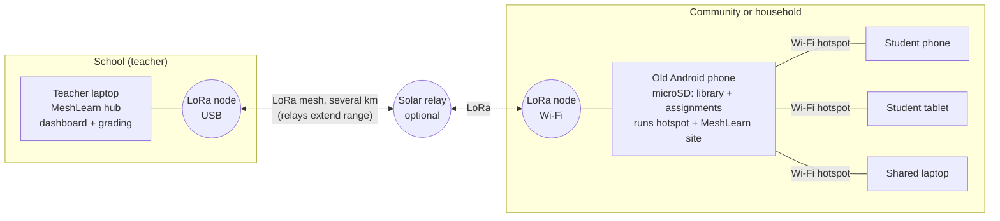

# MeshLearn

**Offline assignments and a local library for students in broadband deserts, linked by LoRa radio.**

ECEP 405 Global Engineering, Team 4 (Accessible Education), Fall 2026 prototype.

A teacher builds interactive assignments on a **teacher hub** and sends them over a Meshtastic LoRa mesh to an **old Android phone** in the community. The phone keeps everything on its microSD card and runs a small website on its own Wi-Fi hotspot. Students join the hotspot with any device, read the offline library, and complete the work. The phone checks answers are complete, saves them, and sends them back to the hub over the radio whenever the link is up. The teacher grades, and the result returns the same way. No internet, cell signal, or ISP is needed at any point.



| Piece | What it does | Runs on |
| --- | --- | --- |
| Teacher hub | Assignment builder, send to phones, auto-grading, manual grading of written answers, CSV export | Any laptop with Python 3.9+ |
| Student phone | Student website: assignments with answer checking, results, offline library, store-and-forward queue | Old Android phone with Termux, data on microSD |
| Mesh link | Compressed, chunked, acknowledged messages with retries that survive lost packets and reboots | Meshtastic radios, or a built-in simulator |
| Library fetcher | Picks the best open content that fits the card (Kiwix offline Wikipedia, Wikibooks, Wikiversity, PhET, Project Gutenberg) in English, Portuguese, or German, and downloads it with resume | Any computer with internet, before deployment |

## Try it in two minutes (no hardware)

Needs Python 3.9 or newer and nothing else.

```bash
git clone https://github.com/Yitz42/Global_Engineering_Group_4.git
cd Global_Engineering_Group_4
python3 -m meshlearn demo
```

Then open:

- **Student phone:** http://localhost:8080. Enter a name, open "Fractions and plants check-in", answer it, and submit.
- **Teacher hub:** http://localhost:8000. Watch the submission arrive, grade the written answer, and save. The student's "My results" page updates over the radio.

The demo links the two with a simulated radio that drops 20% of packets, so you can see retries working. Change it with `--loss 0.5`.

## Running on real hardware

1. **Get radios.** See [docs/hardware.md](docs/hardware.md) for recommended boards, antennas, power, and the right frequency band for the US, Brazil, Germany, and Kenya.
2. **Flash Meshtastic** on each radio (https://flasher.meshtastic.org), set the region, and put all radios on the same channel.
3. **Teacher hub:** plug a radio into the laptop by USB and run:
   ```bash
   pip install meshtastic
   python3 -m meshlearn hub --radio-serial /dev/ttyUSB0      # Windows: --radio-serial COM3
   ```
   Open http://localhost:8000. On the **Phones** page, add each community phone by its radio node id (for example `!a1b2c3d4`). Phones also register themselves the first time they say hello.
4. **Student phone:** follow [docs/android-setup.md](docs/android-setup.md) to install Termux, put the data on the microSD card, connect the phone to its radio over Wi-Fi, and start:
   ```bash
   python -m meshlearn phone --data ~/storage/external-1/meshlearn --hub '!a1b2c3d4' --name "North village" --radio-host 192.168.43.20
   ```
5. **Fill the library** before the phone leaves an area with internet:
   ```bash
   python3 -m meshlearn library --sd-gb 32 --lang pt --dest /Volumes/SDCARD/Android/data/com.termux/files/meshlearn/library --dry-run
   ```
   Drop `--dry-run` to download. Run it again to resume an interrupted download.

## What fits on the card

The fetcher looks up current file sizes from the Kiwix catalog every time it runs, so these plans change as the collections are updated. Example plans from October 24, 2026, keeping 2 GB free for assignments and the system:

| Card | English | Portuguese | German |
| --- | --- | --- | --- |
| 8 GB | PhET, Wikipedia 100, 10 classic books, Best of Wikipedia (mini), Wikibooks (text) — 4.3 GB | — | — |
| 16 GB | — | PhET, Wikilivros, all of Wikipedia (text only) — 7.3 GB | — |
| 32 GB | PhET, 10 classic books, Wikibooks, Wikiversity, all of Wikipedia (article intros) — 23.1 GB | — | — |
| 64 GB | — | — | PhET, Wikibooks, all of Wikipedia with images — 52.3 GB |

Run `python3 -m meshlearn library --sd-gb <size> --lang <en|pt|de> --dest <folder> --dry-run` to see the plan for any card. Content keeps its original license (Wikipedia projects: CC BY-SA; PhET: CC BY 4.0; Project Gutenberg texts: public domain in the USA).

## How the mesh link works

- **Small packets.** LoRa carries about 230 bytes per packet. Each message is JSON, compressed with zlib, split into 200-byte frames, and tagged with a message id and frame number. The sample five-question assignment is 3 packets.
- **Nothing is lost.** Every outgoing message is written to SQLite before it is sent. The receiver acknowledges each complete message, and the sender retries with growing gaps (30 s up to 10 min on real radios) until it hears back. If a phone reboots or the link is down for days, the queue picks up where it left off.
- **No duplicates.** The receiver remembers message ids it has handled and re-acknowledges repeats without acting on them twice.
- **Integrity.** A CRC32 over each message's content catches anything corrupted in reassembly.
- **The answer key stays home.** In graded mode the hub strips the answers before sending, and grading happens on the hub. In practice mode the key goes to the phone so students get instant right/wrong feedback.
- **Separate from chat.** MeshLearn uses Meshtastic's `PRIVATE_APP` port, so ordinary Meshtastic text messages on the same mesh are unaffected.

## Accessibility and adaptation built in

- Works in any browser on any device that can join Wi-Fi; no app install for students.
- Large touch targets, visible labels on every field, error messages linked to their fields for screen readers, and light and dark themes that follow the device.
- Numbers accept `3.5`, `3,5` (comma decimals used in Brazil and Germany), and fractions like `3/4`.
- Library language per phone (English, Portuguese, German); text-only and smaller editions chosen automatically for small cards.
- Students identify themselves by name only. No accounts, passwords, or personal data beyond what the teacher needs.

## Project layout

```
meshlearn/
  protocol.py        message format: compression, framing, CRC, reassembly
  transport.py       simulated radio (UDP) and real Meshtastic radios (USB or Wi-Fi)
  messenger.py       store-and-forward delivery with acks, retries, de-duplication
  assignments.py     question types, answer checking, grading
  hub.py             teacher dashboard
  phone.py           student website and library browser
  library.py         open-content planner and downloader
  web.py             tiny standard-library web framework
  starter_library/   three short original lessons included on every phone
  sample_assignment.json
tests/test_meshlearn.py
docs/hardware.md, docs/android-setup.md
```

## Tests

```bash
python3 -m unittest discover -s tests -v
```

The 15 tests cover framing and corruption, grading and validation, the library planner, delivery of five messages through 40% simulated packet loss (each delivered exactly once), and a full loop through both websites: teacher sends, student answers, teacher grades, result returns.

## Status and limits

Tested:

- Everything above, on Python 3.9 on macOS, using the simulated radio.
- The library fetcher's live lookups against the Kiwix catalog and Project Gutenberg, and a real download.

Not yet tested:

- **Real Meshtastic radios.** `MeshtasticTransport` follows the Meshtastic Python API but has not been run against hardware.
- **Termux on Android.** The steps in the setup guide have not been run on a phone yet.
- **Airtime and range at the pilot site.** Field testing will set the retry timing and show how many relays a site needs.

Still to build:

- Multimedia in assignments.
- Teacher accounts.
- Over-the-air library updates.
- Encryption beyond Meshtastic's channel key.

## Team

Karen Makena, Yitzchuk Rosenblat, Bruck Asefa, James Shamshoian, Fiona Acquah, with partners at H-BRS (Germany) and Instituto Mauá (Brazil).
